

<a href="https://juststealthit.xyz">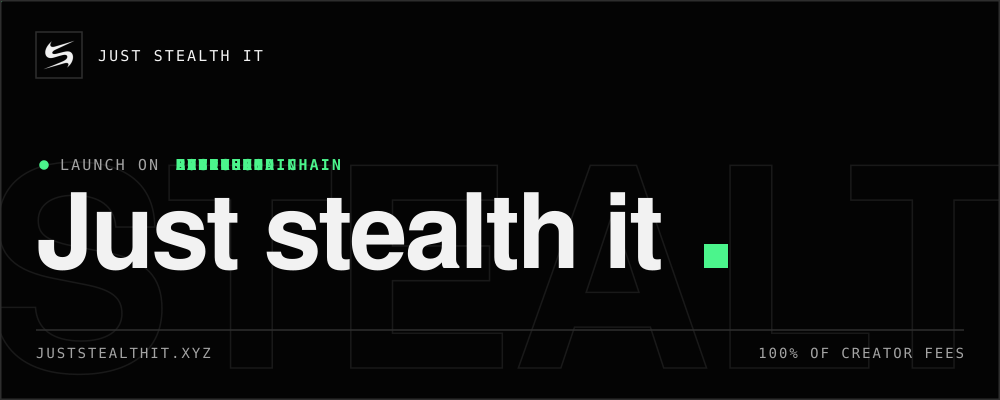</a>

### Launch on every chain. Earn from one place.

A launchpad and trading terminal for Solana and five EVM chains. 
Pick a venue, pick where the fees go, and launch. 100% of creator fees go where you say.

<a href="https://juststealthit.xyz"></a>

<a href="https://t.me/juststealthit"></a>
<a href="https://github.com/juststealthit/smart-contracts"></a>
<a href="https://github.com/juststealthit/docs"></a>
<a href="https://github.com/juststealthit/sdk"></a>

 


## How the money flows

Every trade pays a tax. The venue takes its own cut where it has one. The rest splits **70 to the coin, 30 to the platform**, and the coin's part goes where its launch type says.


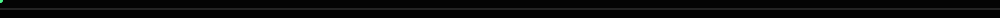

## Singular or multi-chain

Every launch type works both ways. You choose under the launch type.

**Singular** makes one coin, where you picked.


**Multi-chain** makes a separate coin on each chain, from one payment.


<b>Multi-chain rules</b>

 

| | |
| --- | --- |
| Home | The chain that pays gas. Solana by default, or any EVM chain with an EVM wallet |
| Total | Gas, launch costs, Relay's fee, dev buy and a small buffer. You see it before you pay |
| Dev buy | Set chain by chain. Leave a chain empty to skip it |
| Pair | The native coin on each chain. A matching stock where one exists |
| A chain fails | It retries, then its share is refunded. Coins that landed stay |
| Unused buffer | Refunded |
| Default limits | $500 a launch, $1,000 a day, 5 launches a day, per wallet |
| Routes home | Creator, Team, A wallet, Social, Marketing, Feed a Coin |
| Stays local | Holders, Diamond Hands, Buy-back, Auto Liquidity |
| EVM wallet paying | Team and Feed a Coin can't run on Solana, so leave Solana out or pay from Solana |

Routing fees home through Relay is built, and it switches on after launch. Until then those fees wait in that chain's pot.

## Launch types

Picked at launch and locked. They work on every venue.

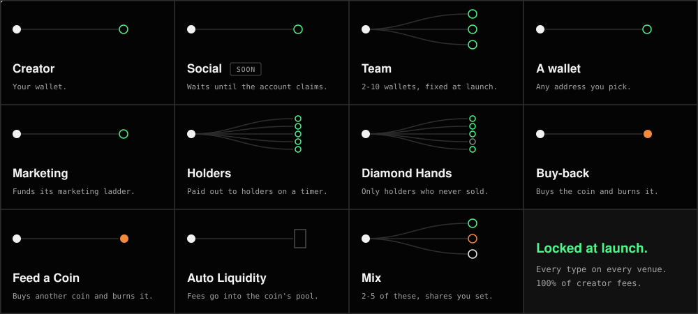

Social is built and coming soon.

## Every fee

Five tax tiers on Raydium, Meteora and the EVM chains. Pump.fun sets its own fee.

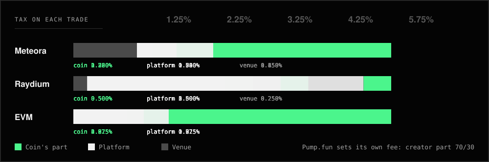

<b>All the numbers</b>

 

What each trade pays, on the curve:

| Tier | EVM coin | EVM platform | Meteora coin | Meteora platform | Meteora | Raydium coin | Raydium platform | Raydium |
| --- | --- | --- | --- | --- | --- | --- | --- | --- |
| **1.25%** | 0.875% | 0.375% | 0.70% | 0.30% | 0.25% | 0.50% | 0.50% | 0.25% |
| **2.25%** | 1.575% | 0.675% | 1.26% | 0.54% | 0.45% | 0.50% | 1.50% | 0.25% |
| **3.25%** | 2.275% | 0.975% | 1.82% | 0.78% | 0.65% | 0.50% | 2.50% | 0.25% |
| **4.25%** | 2.975% | 1.275% | 2.38% | 1.02% | 0.85% | 0.50% | 3.50% | 0.25% |
| **5.75%** | 4.025% | 1.725% | 3.22% | 1.38% | 1.15% | 0.50% | 5.00% | 0.25% |

Raydium caps the coin at 0.5% on its curve, so higher tiers there add only to the platform's part.

| Venue | After graduation |
| --- | --- |
| Pump.fun | PumpSwap pool. Pump's creator fee keeps splitting 70 / 30, locked on chain |
| Raydium | CPMM pool, LP locked. 1.25% tier: 0.75% LP + 0.5% coin. Other tiers: 0.7% LP + 0.8% coin |
| Meteora | DAMM v2 pool at the coin's rate, capped at 10%, to the locked LP |
| EVM chains | No migration. The same pool and the same tier for life. LP fee 0 |

| Other costs | |
| --- | --- |
| Launch | Network fees and rent. EVM launch fee is 0 on all five chains |
| Meteora config | About 0.006 SOL when the pair or rate has no shared config |
| First buy | Up to 5% of supply, lands with the launch, pays the tier |
| Relay | Its own fee when money crosses chains. Shown before you pay |
| Global tax | Meteora only, 0.5% to 5%. Built and off for now |

There's no separate trade fee on top of the coin's tax.

## Anti-sniper

On Meteora and every EVM chain, the first 15 seconds cost up to 90%.

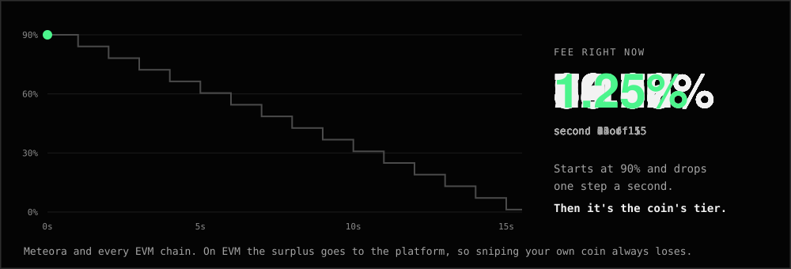

## Open

| Repo | What's in it |
| --- | --- |
| [**smart-contracts**](https://github.com/juststealthit/smart-contracts) | The EVM contracts, each chain's addresses, Solana configs, animated walkthroughs |
| [**docs**](https://github.com/juststealthit/docs) | How everything works, page by page |
| [**sdk**](https://github.com/juststealthit/sdk) | Launch and trade from your own code, on EVM and Solana |

**$STEALTH** on Solana: `GoDSW31bTxfkoup9yA1qcGGx9RMXdTEWgApv3xzBmoA`

The EVM contracts are live and have not been audited. Coins are risky, and fees only exist if people trade. Nothing here is financial advice. Just Stealth It is not affiliated with Pump.fun, Raydium, Meteora, Robinhood, BNB Chain, Hyperliquid, Base, Circle or Solana Foundation.
